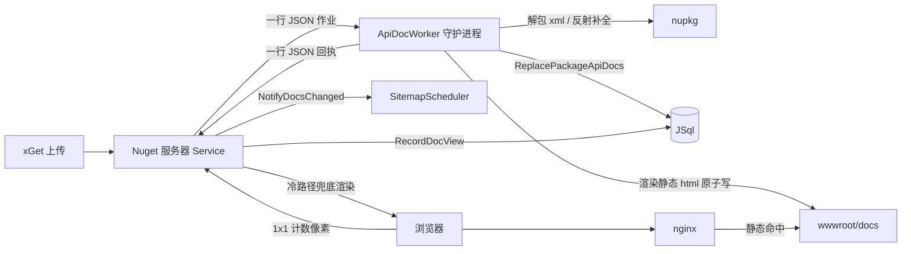

## 用户需求

现有 NuGet 站点的随包 API 文档由服务端在请求线程内从数据库读取文档数据并实时渲染伪静态页面，在双核 2GHz / 3GB 的低配服务器上并发压力过大。需要把文档生成改造为「独立守护进程 + 任务队列」的异步离线管线，把 CPU 密集型工作从 Web 服务器进程移出，并让生成的静态 HTML 由 nginx 直接命中。

## 产品概述

Nuget 服务器启动时同步拉起一个常驻的文档生成守护进程；用户上传 nupkg 后，服务器只把「为这个包生成文档」作为作业投递到队列并立即返回。守护进程在后台单线程顺序完成：解包 lib 目录、提取 XML 注释（并反射补全）、写入文档数据库、渲染出完整的静态 HTML 页面树，供 nginx 直接作为静态文件返回。文档生成失败或进程崩溃都不影响包发布，并能在重启后自动补齐。

## 核心功能

- **常驻文档守护进程**：独立的 `ApiDocWorker` 进程，服务器启动时拉起，随服务器退出；崩溃自动重启并恢复未完成作业。
- **作业队列**：stdin/stdout 一行一个 JSON 的作业与回执协议；单线程顺序消费，作业按「包 id + 版本」去重合并。
- **异步上传**：上传流程只入队并立即返回，不再在请求线程内解析与渲染；守护进程不可用时回退到原有同步路径。
- **文档流水线**：解包 lib → 提取 XML 注释与反射补全 → 写入文档表 → 渲染包索引页与全部类型页 → 重建全局文档索引。
- **静态页面树**：输出到 `wwwroot/docs/{id}/{version}/{type}.html`，文件树与 URL 一一对应，nginx 以 wwwroot 为 docroot 直接命中；原子写入，重传时清理陈旧页面。
- **启动对账与周期校准**：自动发现「库里有文档但静态页缺失/不完整」的包版本并入队补齐；隐藏/已删除的包自动清理其静态目录；失败作业按次数退避重试并记录告警。
- **访问统计保留**：静态页内嵌 1x1 计数像素，由服务器极轻量计数，原有的每日文档访问量与前端曲线继续有效。
- **兜底渲染**：服务器端 `/docs` 动态渲染保留为冷路径，仅在静态文件尚未生成时生效，避免上传后短暂的 404。

## 视觉与体验

站点页面样式、文档页模板与品牌风格完全不变，用户感知的变化只有：文档页首次可访问时间从「上传完成即渲染」变成「入队后由后台进程生成」，且页面响应从服务端计算变为 nginx 直接返回静态文件，明显更快。

## 技术栈选择

- 语言与运行时：VB.NET / `net10.0`，沿用现有 `src/Nuget`（类库，Fluteway 反射加载）、`src/Readership`（文档模型与渲染片段）、`src/ApiDocWorker`（控制台）
- 数据访问：JSql（`NugetStore`），两侧均启用 `StorageOptions.MultiProcessAccess = True`（逐语句释放表级文件锁，任一时刻单写者）
- 进程通信：子进程 stdin/stdout 行分隔 JSON（无端口、无额外依赖）
- 静态托管：nginx 以 `wwwroot` 为 docroot 命中 `docs/**`
- 无新增第三方依赖

## 实现方案

**总体思路**：把「提取 + 写库 + 渲染」整体迁移到常驻 worker；服务器只负责入队、回执消费与极轻量的计数。

**1. 作业与回执契约**（`src/Readership/WorkerContract.vb` 扩展）

- `ApiDocWorkerJob`：`id`（GUID，幂等键）、`action`（`index` / `rebuild`）、`packageId`、`version`、`nupkg`（绝对路径）、`attempt`。
- `ApiDocWorkerResponse`：`id`、`ok`、`message`、`warnings`、`types`、`pages`、`elapsedMs`、`documents`（是否写入了文档）。
- 保留现有 `ApiDocWorkerResult` 与一次性 `--nupkg/--output` 模式，作为回退与自检入口。

**2. 静态页生成与对账**（新增 `src/Nuget/DocPageCache.vb`）

- 路径映射单一实现（生成端与对账端必须共用）：
- URL 侧继续用 `Uri.EscapeDataString`（与 `DocUrls.NugetTypeUrl` / `ApiDocPages.PackageIndexUrl` 完全一致）；
- 磁盘侧使用**未转义**的 `id` / `version` / 类型 `fullName` 作为目录与文件名——nginx 会先解码 URI 再映射文件系统，两侧必须对称。
- 名字含文件系统非法字符（仅 Windows 本地开发可能出现）时记 warning 并跳过该类型页。
- `WritePackageVersion(document, records, packageId, version, versions, config)`：渲染包索引页 + 每个类型页，写入临时文件后 `File.Move(overwrite:=True)` 原子替换；按期望文件集删除本次未生成的陈旧 `*.html`；返回页面数。
- `WriteGlobalIndex(records, config)`：重建 `docs/index.html`；作业完成后按「防抖窗口（默认 5s）」合并多次重建。
- `RemovePackage(packageId)` / `PruneVersions(packageId, keep)`：隐藏包与已删除版本清理。
- `ReadManifest(packageId, version)`：可选 `.manifest.json` 记录生成的类型清单与模板指纹，供对账快速判定「完整/过期」。

**3. 渲染层解耦**（`src/Nuget/ApiDocPages.vb` 修改）

新增不依赖 `store` 的重载，供 worker 直接使用内存中的记录：
`RenderPackageIndex(records, packageId, version, versions, config)`、`RenderTypePage(records, packageId, version, typeFullName, config)`、`RenderGlobalIndex(records, config)`；现有 `store` 版本改为「读库 + 调用新重载」，保证服务端兜底与 worker 输出**逐字节一致**。

**4. 守护进程**（`src/ApiDocWorker` 改造）

- `Program.vb`：解析 `--daemon` / `--db` / `--packages` / `--wwwroot` / `--template` / `--parent-pid` / `--reconcile-seconds` / `--log`；启动时 `Console.SetOut(Console.Error)`（日志走 stderr），保存原始 stdout 仅用于协议行。
- 新增 `WorkerDaemon.vb`：`BlockingCollection(Of ApiDocWorkerJob)` 单线程消费；作业执行 → 回执；`stdin` 读线程；每 `reconcile-seconds`（默认 300）做一次对账；`stdin` EOF 或父 pid 消失即退出；失败重试 `--max-attempts`（默认 3）并退避。
- 作业执行顺序：`NupkgReader.ExtractLibComments` → `ApiDoc.Extract(ReflectSupplement:=True)` → `NugetStore.ReplacePackageApiDocs`（多进程模式，`LockWaitTimeoutMs` 放大到 15s）→ `DocPageCache.WritePackageVersion` → 防抖 `WriteGlobalIndex`。
- 对账：`ReadApiDocIndex()` 汇总期望文件集 → 缺失/不完整入队；`GetHiddenPackageIds()` 与非现有版本 → 删目录；一次对账只做一次全表读。

**5. 服务器侧客户端**（新增 `src/Nuget/ApiDocWorkerClient.vb`）

- `Start()`（`Service.Mount` 内调用）：按 `AppContext.BaseDirectory` 定位 `ApiDocWorker.exe` 或 `dotnet ApiDocWorker.dll`，`UseShellExecute=False` + 三个流重定向，`Kill(entireProcessTree:=True)` 语义的停止方法。
- 队列：`ConcurrentQueue` + 去重字典（同 `id+version` 保留最新）+ 后台写线程；读线程逐行解析回执，失败/成功均落日志，成功后 `sitemap.NotifyDocsChanged()`。
- 崩溃：`Exited` 事件触发指数退避重启（1s/2s/5s/15s，上限 60s），并把正在执行的作业重新入队。
- 关闭：关闭 stdin；worker 侧 EOF 退出，避免孤儿进程。
- `Service.uploadPackage`：`indexApiDocs(pkg)` 改为 `worker.EnqueueIndex(...)` + `sitemap.NotifyDocsChanged()` 后立即返回；`apidoc-worker-fallback-sync=true` 且 worker 不可用时，退回现有 `PackageApiDocs.Extract` 同步路径。

**6. 访问计数**（`Service.vb` + 模板）

- 新增 `GET /api/doc-view/{id}/{version}`：`IsPackageHidden` 则直接返回图片不计数；否则 `store.RecordDocView(id)`；返回 32 字节 1x1 透明 PNG，`Cache-Control: no-store, no-cache, must-revalidate`，`Pragma: no-cache`，不写访问日志噪音。
- `DocPageModel` 增加 `doc_pixel` 值；三份模板在 `</body>` 前加入 `{{doc_pixel}}`；渲染后若成品 html 未包含计数 URL（用户自定义模板没有该占位符）则在 `</body>` 前补插一次，避免漏计或重复计。

**7. 保留的服务端路径**

- `/docs`、`/docs/index.html`、`/docs/{id}/{version}/{name}.html` 全部保留（静态文件缺失时的冷路径，仍做隐藏包检查与 `RecordDocView`）。
- `SitemapGenerator` 只扫描 `wwwroot` 顶层 `*.html`，因此 `wwwroot/docs/**` 不会重复收录；文档 URL 仍来自 `ReadApiDocIndex`，回执触发 `NotifyDocsChanged` 后由既有空闲调度重建。

**关键决策与理由**

- 选 stdin/stdout 而非 TCP/文件队列：不占端口、无防火墙与重连逻辑，进程生命周期天然绑定服务器；缺点是必须处理「日志污染协议」，通过重定向 `Console.Out` 到 stderr 解决。
- worker 直接写库而非回传给服务器写：上传请求完全脱离 CPU 密集路径，且 `MultiProcessAccess` 已具备逐语句锁语义；写冲突用 15s 锁等待 + 单线程串行规避。
- 静态文件放 `wwwroot/docs` 而非独立目录：URL 与文件树 1:1，nginx 与 Fluteway 的静态监听都能直接命中，零额外路由配置。
- 保留动态 `/docs` 兜底：上传后到 worker 生成完成之间存在窗口，兜底可避免 404，且只有冷请求才会触发。
- 启动对账而非全量重建：低配机器上全量重渲染代价过高；按「缺失/不完整」增量入队，代价与偏差成正比。

**性能与可靠性**

- 队列单线程：任意时刻只有 1 个渲染任务，CPU 峰值可控；作业内渲染为 O(类型数 × 成员数)，与前一次实现相同，但离开请求线程。
- 服务器请求路径新增成本仅为「一次入队 + 一次 JSON 序列化」，计数像素为一次内存响应 + 一次单行计数写。
- 静态文件命中后 nginx 直接返回，Fluteway 完全不参与，文档页并发压力归零。
- 原子写 + 陈旧清理保证任何时刻读者看到的都是完整页面；对账保证崩溃/强杀后的自愈。

## 架构设计



职责边界：`Service` 只做入队、回执消费与计数；`ApiDocWorkerClient` 只做进程与队列管理；`WorkerDaemon` 只做作业执行与对账；`DocPageCache` 只做「文档模型 → 磁盘文件」；`ApiDocPages` 只做「文档模型 → html 文本」。服务端兜底与 worker 共用同一渲染函数，保证两边输出一致。

## 目录结构

```
g:/xDoc/
├── src/Readership/
│   ├── WorkerContract.vb            # [MODIFY] 新增 ApiDocWorkerJob / ApiDocWorkerResponse（作业与回执契约），保留 ApiDocWorkerResult 一次性契约
│   └── ApiDocRenderer.vb            # [MODIFY] DocPageModel 增加 doc_pixel 值；提供 pixel html 片段构造（含 base 与 id/version 转义）
├── src/Nuget/
│   ├── DocPageCache.vb              # [NEW] 静态页缓存核心：URL↔文件路径映射（转义/未转义两侧对称）、包索引页与类型页渲染写出、
│   │                                #   原子替换、期望文件集比对与陈旧 html 清理、全局索引重建与防抖、隐藏包/消失版本目录删除、清单读写
│   ├── ApiDocPages.vb               # [MODIFY] 增加不依赖 store 的渲染重载（records + config），store 版本改为读库后转调；统一 fallback 模板
│   ├── ApiDocWorkerClient.vb        # [NEW] 守护进程客户端：定位可执行文件、启动/停止、stdin 写线程、stdout 读线程、作业去重队列、
│   │                                #   崩溃指数退避重启与在途作业重投、回执分发（日志 + sitemap 通知）、不可用判定
│   ├── PackageApiDocs.vb            # [MODIFY] 保留一次性 worker 调用与进程内回退；对外暴露 toRecords 供 worker 复用（或迁移到共享位置）
│   ├── Service.vb                   # [MODIFY] Mount 启动/关闭客户端；uploadPackage 改为入队（含同步回退开关）；
│   │                                #   新增 GET /api/doc-view/{id}/{version} 极轻量计数；/docs 路由保留为兜底并复用新渲染重载
│   └── NugetConfiguration.vb        # [MODIFY] 新增 apidoc-worker-enabled / -path / -reconcile-seconds / -max-attempts / -fallback-sync、
│                                    #   docs-static-output、doc-view-pixel；同步私有构造、FromConfig、默认常量
├── src/ApiDocWorker/
│   ├── Program.vb                   # [MODIFY] 解析 --daemon 及守护参数；保留 --nupkg/--output 一次性模式；
│   │                                #   守护模式启动时把 Console.Out 重定向到 stderr，仅原始 stdout 写协议
│   ├── WorkerDaemon.vb              # [NEW] 作业队列消费（单线程）、提取与写库、静态页生成、回执、启动对账与周期对账、
│   │                                #   失败重试与退避、父进程看护与 stdin EOF 退出
│   └── ApiDocWorker.vbproj          # [MODIFY] 确保输出到 dist/bin 且与 Nuget/Readership 引用一致（如需要补充程序集说明/启动参数）
├── dist/
│   └── template/
│       ├── docs-index.html          # [MODIFY] 在 </body> 前加入 {{doc_pixel}}
│       ├── docs-package.html        # [MODIFY] 同上
│       └── docs-type.html           # [MODIFY] 同上
├── test/
│   ├── Program.vb                   # [MODIFY] 新增 staticdocs 子命令分派
│   └── StaticDocsTest.vb            # [NEW] 不启动 http 的静态页自检：给定 nupkg + 输出目录，生成后校验文件树、内部链接、
│                                    #   计数像素、陈旧文件清理与重复生成幂等
├── .gitignore                       # [MODIFY] 忽略 dist/wwwroot/docs/（运行时生成的静态文档树）
└── README.md                        # [MODIFY] 新增「文档生成守护进程」章节：进程模型、JSON 协议、配置项、输出目录、
                                     #   对账/重试语义、nginx 片段样例、排障与监控要点；同步 §1 目录结构与 §12 行为描述
```

## 关键代码结构

```
' src/Readership/WorkerContract.vb —— 进程间契约（接口级）
Public Class ApiDocWorkerJob
    Public Property id As String
    Public Property action As String          ' index / rebuild
    Public Property packageId As String
    Public Property version As String
    Public Property nupkg As String
    Public Property attempt As Integer
End Class

Public Class ApiDocWorkerResponse
    Public Property id As String
    Public Property ok As Boolean
    Public Property message As String
    Public Property warnings As New List(Of String)
    Public Property types As Integer
    Public Property pages As Integer
    Public Property elapsedMs As Long
End Class

' src/Nuget/DocPageCache.vb —— 静态页生成契约（接口级）
Public Module DocPageCache
    ' URL 转义 → 磁盘未转义 的唯一映射实现
    Public Function VersionDirectory(config As NugetConfiguration, packageId As String, version As String) As String
    Public Function TypeFilePath(config As NugetConfiguration, packageId As String, version As String, typeFullName As String) As String

    ' 渲染并原子落盘；返回写入的页面数，并清理期望文件集之外的陈旧 html
    Public Function WritePackageVersion(config As NugetConfiguration, packageId As String, version As String,
                                        records As IList(Of PackageApiDocRecord), document As ApiDocDocument) As Integer

    ' 全局索引（跨包），带防抖
    Public Function WriteGlobalIndex(config As NugetConfiguration, records As IList(Of PackageApiDocRecord)) As Boolean

    ' 对账与清理
    Public Function PrunePackage(config As NugetConfiguration, packageId As String) As Integer
End Module
```

## 实施注意

- **协议与日志隔离**：worker 内所有 `.info()/.debug()/.warning()` 必须走 stderr；stdout 只允许回执行。服务器侧把 stderr 逐行转发到自身日志并加 `[apidoc-worker]` 前缀，避免淹没主日志。
- **跨进程写库**：worker 的 `StorageOptions` 必须 `MultiProcessAccess=True`、`LockConflictPolicy=Wait`、`LockWaitTimeoutMs≈15000`；两个进程都不要开 `IdleMergeScheduler`（多进程模式自动关闭）。
- **幂等**：同一 `(id, version)` 重复作业必须可安全重跑（先删后插 `ReplacePackageApiDocs`，静态页整目录重写）。
- **失败不影响发布**：`uploadPackage` 的入队调用必须包在 Try/Catch 内，失败仅 warning；包发布结果与文档生成完全解耦。
- **隐藏包窗口**：静态文件绕过 `IsPackageHidden`，需由对账删除目录；文档中明确「最长一个对账周期」的可见性窗口。
- **不做无关重构**：`/docs` 动态路由、sitemap、统计接口均保留现有行为，避免扩大改动面。
- **回归验证**：改造后用现有 `test serverdocs` 与新 `test staticdocs` 做双保险；再用本机启动服务 + 浏览器验证「静态页命中、计数像素生效、上传后自动生成、强杀 worker 后自愈」。

## Agent Extensions

### SubAgent

- **code-explorer**
- Purpose: 在改造 `Service.vb` 与 `ApiDocPages.vb` 前，完整核对所有文档渲染入口、上传写入点、`/docs` 路由与 `RecordDocView` 调用点，避免入队改造后遗漏或破坏既有行为。
- Expected outcome: 一份精确的「需改造位置清单」（文件、行号、方法、调用关系），据此完成改造且不引入编译错误或行为回归。

### Skill

- **agent-browser**
- Purpose: 本地启动服务后验证静态文档页可被直接命中、页面样式与链接完整、1x1 计数像素成功触发且文档访问量增长。
- Expected outcome: 页面截图与文本检查结果，以及 `/api/doc-view/...` 请求与 `package_doc_activity` 计数变化的证据。